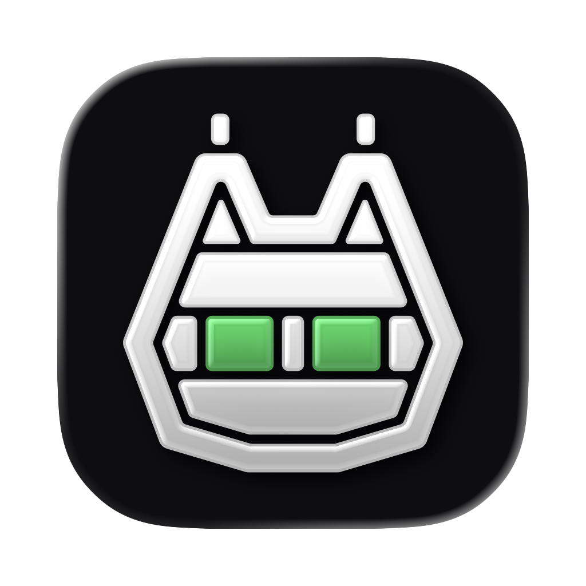

# Lynx Battery

A macOS menu bar app that shows what your battery is doing and stops it charging past the limit you set.

Requires macOS 14 or later on Apple silicon.

## Install

```sh
brew install --cask mansfera/tap/lynx-battery
```

If Homebrew asks you to trust the tap first, run `brew trust --tap mansfera/tap`. To update, run `brew upgrade --cask lynx-battery`. If the charge-limit helper is installed, the upgrade asks for your password to replace it, and charging runs as normal for the few seconds that takes. With no helper it doesn't ask.

Or download the DMG from [Releases](https://github.com/Mansfera/lynx-battery/releases) and drag the app to Applications.

The app is ad-hoc signed and not notarized. The Homebrew cask clears the quarantine flag after install. With the DMG, the first launch needs right-click → Open, or System Settings → Privacy & Security → Open Anyway.

To build it yourself:

```sh
./build.sh
open "Lynx Battery.app"
```

## Features

### Overview
Charge, health (what the battery holds right now ÷ its design capacity, the same mAh shown under it), cycles, battery temperature, how much power the Mac is drawing, 24-hour, 7-day and 30-day history, and Low Power Mode. With the charge-limit helper installed, Settings can make right-clicking the menu bar icon toggle Low Power Mode. Otherwise right-click opens the popover.

### Charge
- A charge limit from 15% to full.
- Sailing mode, so the battery doesn't top up every time it dips under the limit.
- Heat protection, which pauses charging above a set temperature (35° by default) and holds for 5 minutes.
- Discharge to the limit when you plug in above it. A monitor or dock on the same cable would go down with the plug, so with one attached the Mac just stops charging and runs down as you use it.
- Top up to full once, then return to the limit.
- Stay awake until the limit, on Macs that need it.
- The MagSafe light shows green while holding and amber while charging.

### Power
A power-flow diagram from the adapter to the battery and the Mac. Its bands always add up to the adapter's input: the battery's charge and the input are read at the same moment (SMC `CHBI` and `PDTR`), and the Mac gets the rest, which includes the loss from charging inside the Mac. On battery the band is the Mac's live draw (SMC `PSTR`), the same reading as the whole-Mac breakdown below, and with that breakdown open both show the same number. Below it, energy use by app (live, 24 hours, 7 days and 30 days), grouped by app bundle. Opening the macOS row shows where the whole Mac's power is going right now, in watts: display, CPU, GPU, memory, Neural Engine, video and camera, the rest of the chip, and everything else, in a fixed order or sorted by usage. Wi-Fi, the SSD and audio have no power sensors, so they show live activity under everything else instead of watts. The backlight has no power sensor of its own, so Display's watts are an estimate from brightness, marked with `~`, measured on the MacBook Air M3 (Mac15,12). Other models show only the brightness, and the screen's watts count under everything else. It's measured only while that row is open.

Energy by app comes from `top`, which runs for about a second per sample. Settings → General → Power tracking sets how often it runs in the background: **Frequent** every 2 minutes, **Normal** every 5 minutes (the default), or **Eco** every 15 minutes, which still gives each hour four samples for the 24-hour, 7-day and 30-day averages. Only these scheduled samples go into the history, so it stays even over time and doesn't fill up with whatever runs while you're looking, including this app drawing the menu.

While the Power tab is open, the power flow refreshes every 2 seconds and energy by app every 10 seconds. The first live sample waits 2 seconds, so it doesn't measure the menu opening. Turn off **Live Power tab** in the same section to keep the usual pace: the battery every 5 seconds and one energy sample when the tab opens.

Minimal energy use cuts the app's own draw. It switches energy by app to Eco and turns off the live Power tab, animations, the screen glow and Bluetooth scans, and reads the battery less often while the menu is closed. Devices refresh only when you open the menu, so their alerts can come late. The charge limit and battery alerts keep working. The charge-limit helper checks in less often too, every 40 seconds instead of 15.

### Devices
AirPods (left, right and case, even before they connect), Magic Mouse, Keyboard and Trackpad, a paired iPhone or iPad nearby, and anything connected that exposes the Bluetooth Battery Service. macOS asks for Bluetooth access the first time you open this tab; until you allow it, iPhone, iPad and other devices read over the Battery Service don't show up or send alerts.

Don't need it? Turn off Track devices in Settings → Alerts. The Devices tab disappears and the app stops reading devices altogether: no Bluetooth scans or connections, no `system_profiler` or `ioreg` reads, no device alerts, and no device in the menu bar of a Mac without a battery. It doesn't ask for Bluetooth access while it's off. Turning it back on picks up again right away, no relaunch needed.

### Alerts
A draggable pill with jelly physics, a screen-edge glow, and a full-screen alert at critical levels. Low and high thresholds are yours to set.

### Updates
Settings → Alerts → Updates has three switches. The first two are on by default:

- **Check for new versions:** asks GitHub for the latest release about 15 seconds after launch, then every 8 hours, and after waking if a check is due. A newer version shows as a banner at the top of the menu, with Download (opens the release page) and a close button that hides the banner until the next version. Drafts and pre-releases are skipped.
- **Alert about new versions:** an alert pill, once per version. It stays until you click it, which opens the release page, or close it with × (or fling it away), whatever **Keep alerts until clicked** says. Closing it offers to turn these alerts off. If a battery or device alert comes in meanwhile, the update alert steps aside and comes back after.

- **Install updates automatically** (off by default): when a new version shows up, the app downloads it, checks it, replaces itself and relaunches, with a short "Updated to X — relaunching" alert. Off, the banner and the alert get an **Install** button that does the same once. If it fails, the banner says why and offers Download instead.

Every release is signed with the developer's Ed25519 key, and the public half is built into the app and the helper. Before anything is replaced, the app checks the DMG against GitHub's sha256 and the signature (`Lynx-Battery-<v>.dmg.sig`), which covers the bundle ID, the version and the DMG's sha256. Then:

- **With the charge-limit helper**, no password. The app drops the DMG and a request into the helper's folder and pings it. The helper trusts none of it and checks everything again on its own copy: the signature with its built-in key, the sha256, a request under 10 minutes old, a DMG file name with no path in it, and a target that is a real `Lynx Battery` app in `/Applications` or `~/Applications` with no symlinks on the way. It mounts the DMG read-only, refuses anything but `com.mansfera.lynxbattery` at exactly the signed version and newer than the installed one, and rejects symlinks pointing out of the bundle, setuid files and broken code signatures. The new app is copied next to the old one with the same owner and swapped in with one atomic rename; the old copy is deleted only after the swap. Each step goes to the helper log. The app then quits and opens itself again as you.
- **Without the helper**, the app does the same checks itself if it can write to its own folder (usual for an admin in `/Applications`). Otherwise it can't replace itself without a password, so the banner offers Download.
- **Installed with Homebrew** (`Caskroom/lynx-battery` exists), it never replaces itself, so brew keeps knowing which version is installed. The banner says to run `brew upgrade --cask mansfera/tap/lynx-battery` and copies the command.

A build without a signing key (`Sources/UpdateKey.swift` empty) can't verify anything, so automatic install is greyed out in Settings and the banner and alert only offer Download.

The request is anonymous: `GET api.github.com/repos/Mansfera/lynx-battery/releases/latest` with a `LynxBattery/<version>` User-Agent and nothing else about you or your Mac. The ETag is kept, so an unchanged answer doesn't count toward GitHub's rate limit, and checks happen at most once an hour even across restarts. Offline or rate-limited, it tries again later without saying anything.

### Percent modes
- **As macOS shows:** the smoothed number from the battery controller.
- **True charge:** remaining ÷ full.
- **Of original capacity:** true charge × health, so a full battery shows its health. In this mode, the Charge tab can still set the limit in true charge, 0–100%.

### App icon
Pick the icon in Settings → General: Green eyes (default), White eyes, Plain or Green cells.

Green eyes is a Liquid Glass icon, so on macOS 26 and later it follows the Dark, Clear and Tinted icon styles. macOS can't swap a glass icon while an app runs, so the other three are set as a custom Finder icon from a pre-rendered image and keep one look in every style. A custom icon makes `codesign --verify` report the bundle as modified, like any icon pasted through Get Info. The app still runs, and choosing Green eyes removes it.

## Macs without a battery

On an iMac, Mac mini, Mac Studio or Mac Pro there is no battery data to show, so Overview, Charge and the battery settings are hidden. A UPS doesn't count as a battery. The menu bar shows the Mac's live power draw instead, Power shows it above energy by app, and Devices works as usual.

The draw comes from the SMC key `PSTR`, falling back to `PDTR`, with no root needed. If a Mac reports neither, the app says so instead of showing a number. It's the power used by the Mac itself, so it's lower than a meter at the wall would show.

## Charge limit helper

The limit runs in a small root LaunchDaemon, installed from the Charge tab with an admin prompt. **Remove helper** in the same tab uninstalls it.

The helper picks a lever per firmware: `CHTE` or `CH0B`+`CH0C` to pause charging, and `CH0I` to cut the adapter. `CHIE` behaves differently across firmware, so its role is self-tested on first use. macOS can reset these keys, so the helper re-checks them every 3 seconds while something is paused. On exit, when the limit is off, or at 10% or below, it restores normal charging. That's why the lowest limit is 15%.

A new limit or setting applies within a second. The app saves it and then pings the helper, which also watches its settings folder. It still re-checks everything every 15 seconds, or every 40 in Minimal energy use.

| What | Where |
|---|---|
| Bundle ID | `com.mansfera.lynxbattery` |
| Helper | `com.mansfera.lynxbattery.helper` |
| Limit settings and status | `/Library/Application Support/com.mansfera.lynxbattery/` |
| History and energy data | `~/Library/Application Support/com.mansfera.lynxbattery/` |
| Helper log | `/var/log/lynx-battery-helper.log` |
| Update request, DMG and result (briefly) | `/Library/Application Support/com.mansfera.lynxbattery/update-request.json`, `Lynx-Battery-<v>.dmg`, `update-result.json` |

Coming from an Etherlynx Battery build, settings and history move over on first launch. The old helper keeps running until you install the new one from the Charge tab, which brings the limit settings across and removes the old helper. Open at login needs turning on again, and macOS asks for Bluetooth access again when you open the Devices tab.

## Not supported

- Apple Watch, which only reports its battery through the iPhone. iPhone and iPad are read over Bluetooth, so they need to be paired with this Mac and nearby.
- Widgets, which need an Xcode app extension.

## Development

Plain `swiftc`, no Xcode project. `build.sh` compiles the app (`Sources/`) and the root helper (`Helper/`), bundles the fonts, marks and icons from `Resources/`, and signs ad-hoc.

```sh
Tests/high-alerts.sh    # alert thresholds in every percent mode
Tests/charge-limit.sh   # limit bounds and scale conversion
Tests/charge-start.sh   # charging starts after a limit change, live charge state
Tests/energy-history.sh # impossible readings stay out of energy by app
Tests/tracking-cadence.sh # how often energy by app is sampled, and the live Power tab
Tests/minimal-energy.sh # what Minimal energy use slows down, renders the Power tab to PNG
Tests/helper-restore.sh # the cask puts the helper back after an upgrade
Tests/right-click.sh    # right-click only toggles Low Power Mode without a password prompt
Tests/desktop-mode.sh   # Macs without a battery, renders each screen to PNG
Tests/power-breakdown.sh # the macOS row's power breakdown, renders it to PNG
Tests/device-tracking.sh # Track devices off stops device reads and Bluetooth, on brings them back
Tests/update-check.sh   # version comparison, GitHub release parsing, when the banner and alert show
Tests/update-verify.sh  # update signatures (throwaway key), request paths, Homebrew detection, when to auto-install
Tests/update-install.sh # the helper's install end to end: real DMGs, tampered and downgraded ones refused, into a temp folder
```

None of these touch the settings, history or charge limit of the installed app, or the app in `/Applications`.

To try the no-battery mode on a MacBook, `SIMULATE_NO_BATTERY=1 ./build.sh` builds the app as if it had no battery, and `SIMULATE_NO_BATTERY=no-watts` also hides the power keys. It's a compile flag, so normal builds don't contain it.

To try the update banner and alert, `SIMULATE_VERSION=1.0.0 ./build.sh` builds an app that reports itself as 1.0.0. It only changes the built bundle's `Info.plist`, and `release.sh` unsets it. The alert shows once per version, so to see it again run `defaults delete com.mansfera.lynxbattery updateAlerted` (and `updateDismissed` for the banner, `updateCheckedAt` to check again right away) before relaunching.

Once per Mac before the first signed release, run `./make-update-key.sh`. It makes an Ed25519 key pair, keeps the private key in your login Keychain (`com.mansfera.lynxbattery.update-signing`) and writes the public key into `Sources/UpdateKey.swift`, which you commit. Back the private key up (Keychain Access → "Lynx Battery update signing key"): installed copies only accept updates signed with it. On another Mac, add the same key to the Keychain under that name first, and the script reuses it. After the key changes, reinstall the helper from the Charge tab (Helper update), since the helper has the key built in.

To publish a version, `./release.sh 1.0.1` checks the signing key first and stops if it's missing or doesn't match `UpdateKey.swift`. Then it builds the app, packages and signs the DMG, creates the GitHub release with the DMG and its `.sig`, and updates the cask in [Mansfera/homebrew-tap](https://github.com/Mansfera/homebrew-tap) from `Homebrew/lynx-battery.rb`.

The icons are generated by `Resources/Icons/generate.py`. To rebuild them, run `Resources/Icons/build-icons.sh`, which needs Xcode 26 or later, ImageMagick and `shapely`. The results are committed, so `build.sh` needs none of this.

## Credits

Designed & developed by [Etherlynx Studio](https://etherlynx.xyz/) & [Ihor Kharkholyuk](https://kharkholy.uk). Made with Claude.

The app was started by Volo Nehoda as Etherlynx Battery, and that work is kept in this repository's history.

Onest and Geist Mono are bundled under the SIL Open Font License 1.1. See `Resources/Fonts/*-OFL.txt`.
